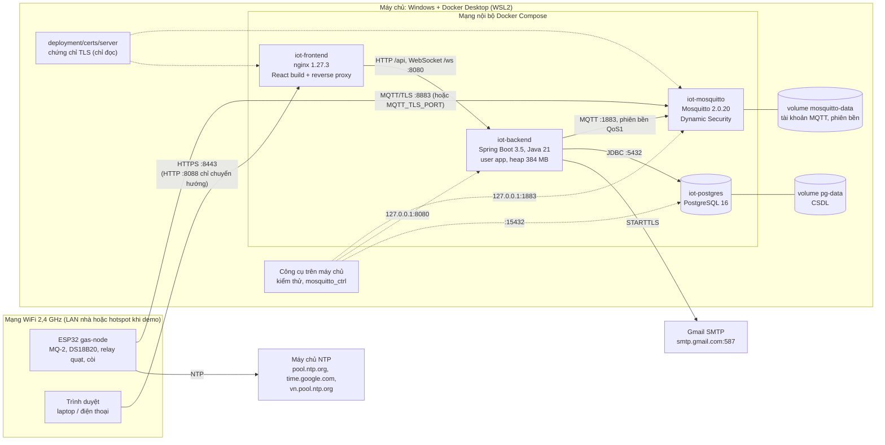

# Sơ đồ triển khai – GasGuard

Toàn bộ phần mềm phía máy chủ chạy bằng **Docker Compose** trên **một máy chủ trong mạng LAN** (laptop Windows với
Docker Desktop/WSL2): 4 container `iot-mosquitto`, `iot-postgres`, `iot-backend`, `iot-frontend`. Thiết bị ESP32 và trình
duyệt kết nối tới máy chủ qua WiFi, mọi đường truyền qua LAN đều mã hóa TLS. Cấu hình: `deployment/docker-compose.yml`,
`deployment/mosquitto/mosquitto.conf`, `frontend/nginx.conf`, `backend/Dockerfile`, `frontend/Dockerfile`.

## 1. Sơ đồ

## 2. Các container

| Container | Image | Vai trò | Cổng trên máy chủ → container | Dữ liệu lưu | Kiểm tra sức khỏe |
|---|---|---|---|---|---|
| `iot-mosquitto` | `eclipse-mosquitto:2.0.20` | Broker MQTT, xác thực và ACL từng thiết bị (Dynamic Security) | `8883` (TLS, đổi bằng `MQTT_TLS_PORT`) → 8883; `127.0.0.1:1883` → 1883 | Volume `mosquitto-data`: tài khoản, ACL, bản tin retained, hàng đợi phiên bền | Docker theo dõi tiến trình |
| `iot-postgres` | `postgres:16-alpine` | CSDL quan hệ và chuỗi thời gian | `15432` → 5432 | Volume `pg-data` | `pg_isready` mỗi 5 s |
| `iot-backend` | `gasguard/backend:1.0.0` (build từ `backend/`) | REST API, tiếp nhận MQTT, cảnh báo, lệnh, vòng đời, WebSocket, email | `127.0.0.1:8080` → 8080 | Không (dữ liệu nằm trong CSDL) | `GET /actuator/health` = UP, mỗi 10 s |
| `iot-frontend` | `gasguard/frontend:1.0.0` (build từ `frontend/`) | Phục vụ giao diện React, HTTPS, chuyển tiếp `/api` và `/ws` tới backend | `8443` → 443 (HTTPS); `8088` → 80 (chuyển hướng) | Không | `GET /healthz` mỗi 10 s |

Thứ tự khởi động (`depends_on`): `postgres` (đợi healthy) và `mosquitto` → `backend` → `frontend` (đợi backend healthy).
Mọi container `restart: unless-stopped`: tự chạy lại khi lỗi hoặc khi khởi động lại Docker.

Image backend build 2 tầng (Maven → JRE alpine), chạy bằng user `app` không phải root, giới hạn heap 384 MB
(`JAVA_OPTS`). Image frontend build 2 tầng (Node 20 → nginx); `nginx.conf` là template, cổng HTTPS điền lúc khởi động.

## 3. Cổng và mã hóa

| Cổng (máy chủ) | Giao thức | Ai kết nối | Mở cho | Mã hóa |
|---|---|---|---|---|
| 8883 (`MQTT_TLS_PORT`) | MQTT qua TLS 1.2/1.3 | ESP32 | Mạng LAN | ✅ TLS, ESP32 kiểm tra chứng chỉ broker bằng CA của nhóm |
| 8443 (`WEB_HTTPS_PORT`) | HTTPS + WebSocket (`wss://`) | Trình duyệt | Mạng LAN | ✅ TLS 1.2/1.3 |
| 8088 (`WEB_PORT`) | HTTP | Trình duyệt | Mạng LAN | Không phục vụ nội dung, chỉ trả 301 sang HTTPS |
| 1883 | MQTT | Backend (trong mạng Docker), công cụ trên máy chủ | Chỉ `127.0.0.1` | Không, nhưng không ra khỏi máy chủ |
| 8080 | HTTP | nginx (trong mạng Docker), bộ kiểm thử | Chỉ `127.0.0.1` | Không, nhưng không ra khỏi máy chủ |
| 15432 | PostgreSQL | Công cụ quản trị CSDL | Máy chủ | Không; xác thực bằng mật khẩu CSDL |

Tường lửa Windows chỉ cần mở cổng MQTT/TLS và 8443 cho mạng **Private**.

Kết nối ra ngoài Internet: backend gửi email qua Gmail SMTP (STARTTLS, cổng 587, dùng DNS 1.1.1.1 / 8.8.8.8); ESP32 lấy
giờ từ máy chủ NTP (`pool.ntp.org`, `time.google.com`, `vn.pool.ntp.org`; bắt buộc trước khi gửi dữ liệu và trước khi bắt tay TLS).

## 4. Bí mật và chứng chỉ

| Thứ | Nằm ở đâu | Vào container nào | Commit? |
|---|---|---|---|
| Mật khẩu CSDL, MQTT backend, `JWT_SECRET`, mật khẩu admin web, mật khẩu ứng dụng Gmail | `.env` ở thư mục gốc | Chỉ biến backend cần; `MQTT_ADMIN_PASSWORD` không vào container nào | ❌ (`.gitignore`) |
| Khóa và chứng chỉ CA (`certs/ca/`) | `deployment/certs/ca/` | Không container nào | ❌ |
| Chứng chỉ, khóa máy chủ (`certs/server/`) | `deployment/certs/server/` | `mosquitto`, `frontend` (chỉ đọc) | ❌ |
| Mật khẩu WiFi, MQTT của thiết bị; CA cho ESP32 | `firmware/gas-node/secrets.h`, `ca_cert.h` | Nạp vào ESP32 | ❌ |
| Mẫu cấu hình | `.env.example`, `secrets.h.example` | | ✅ (không có giá trị thật) |

Compose dừng ngay nếu thiếu biến bắt buộc (`POSTGRES_PASSWORD`, `MQTT_BACKEND_PASSWORD`, `JWT_SECRET`,
`APP_ADMIN_PASSWORD`). Image không chứa bí mật nào; mọi giá trị truyền lúc chạy.

## 5. Triển khai

Các bước chi tiết: `README.md` mục 5 và `deployment/README.md`. Tóm tắt:

1. Tạo `.env` từ `.env.example` và đặt mật khẩu riêng.
2. Tạo chứng chỉ: `deployment/certs/gen-certs.sh <các IP LAN của máy chủ>` (chạy trong Docker).
3. Lần đầu: khởi tạo tài khoản `admin` và `backend` trong Mosquitto Dynamic Security.
4. `docker compose --env-file ../.env --profile app up -d --build` (trong `deployment/`).
5. Mở tường lửa; nạp firmware cho ESP32 với `secrets.h` lấy từ trang cấp thông tin xác thực và `ca_cert.h`.

**Đổi mạng khi demo** (ví dụ hotspot điện thoại): thêm IP mới vào chứng chỉ bằng `gen-certs`, khởi động lại `mosquitto` và `frontend` để nạp chứng chỉ mới; CA
giữ nguyên nên không phải nạp lại CA cho ESP32, chỉ sửa `MQTT_HOST` và WiFi trong `secrets.h` nếu đổi.

**Chạy để phát triển:** chỉ chạy `mosquitto` và `postgres` bằng Docker; backend chạy trong IntelliJ, frontend chạy
`npm run dev`.

## 6. Quyết định thiết kế

- **Docker Compose:** cả hệ thống dựng bằng một lệnh, giống nhau trên mọi máy, dễ cho giảng viên chạy lại; phiên bản
  image được ghim cố định (không dùng `latest`).
- **Chỉ mở ra LAN những cổng có mã hóa:** MQTT/TLS và HTTPS; các cổng không mã hóa (1883, 8080) chỉ bind `127.0.0.1`.
- **nginx làm cổng vào duy nhất của web:** trình duyệt làm việc với một origin (không cần mở CORS), WebSocket đi
  chung kết nối HTTPS; nginx ghi đè `X-Forwarded-For` để audit log ghi đúng IP người dùng, không bị giả mạo.
- **Khóa CA không vào container:** container chỉ được gắn thư mục chứng chỉ máy chủ, ở chế độ chỉ đọc.
- **Dữ liệu trong volume:** xóa và dựng lại container không mất CSDL, tài khoản MQTT; chỉ mất khi chủ động xóa volume.
- **Phiên MQTT bền cho backend:** khởi động lại backend hoặc broker không làm mất bản tin QoS1 (đo ở P4).
- **Một máy chủ cho nguyên mẫu:** đủ cho quy mô đo được ở P8 (100 thiết bị mô phỏng, 100 bản tin/s, không mất bản tin);
  RAM backend tối đa khoảng 400 MiB (P6).

## 7. Kiểm thử chứng minh

| Ca | Nội dung |
|---|---|
| S9 | Từ IP LAN: cổng 1883 đóng, cổng MQTT/TLS mở; MQTT không mã hóa vào cổng TLS bị từ chối; HTTP chuyển sang HTTPS |
| P4 | Khởi động lại broker và backend (`docker restart`), hệ thống tự kết nối lại, không mất bản tin |
| P6 | CPU, RAM từng container đo bằng `docker stats` |
