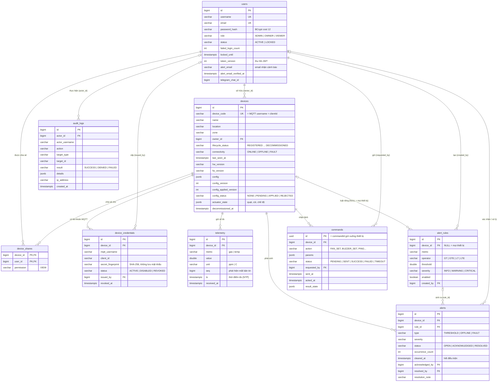

# Mô hình dữ liệu (ERD) – GasGuard

CSDL PostgreSQL 16 gồm **9 bảng**: người dùng, thiết bị (kèm chia sẻ quyền và tài khoản MQTT), dữ liệu đo, luật cảnh
báo, cảnh báo, lệnh điều khiển và nhật ký thao tác. Schema do Flyway tạo theo thứ tự các file
`backend/src/main/resources/db/migration/V1…V5`, mọi thời gian lưu theo UTC (`TIMESTAMPTZ`).

## Sơ đồ

Sơ đồ chỉ ghi các cột chính; đủ cột và kiểu dữ liệu xem các file migration.

## Các bảng

| Bảng | Lưu gì | Migration |
|---|---|---|
| `users` | Tài khoản, vai trò, trạng thái khóa, bộ đếm đăng nhập sai, phiên bản token, email/Telegram nhận cảnh báo | V1, V4, V5 |
| `devices` | Thiết bị, chủ sở hữu, vị trí/khu vực, trạng thái vòng đời và kết nối, phiên bản phần cứng/firmware, cấu hình và trạng thái quạt/còi | V1, V2 |
| `device_shares` | Người dùng được chia sẻ quyền **xem** một thiết bị | V1 |
| `device_credentials` | Lịch sử tài khoản MQTT của thiết bị: cấp, đổi, thu hồi | V1 |
| `telemetry` | Từng số đo: chỉ số, giá trị, đơn vị, số thứ tự `seq`, thời điểm đo và thời điểm nhận | V1 |
| `alert_rules` | Luật ngưỡng; 3 luật mặc định cho mọi thiết bị (gas > 400 ppm, gas > 1000 ppm, nhiệt độ > 50 °C) | V1, V3 |
| `alerts` | Cảnh báo và quy trình xử lý: mở → xác nhận → đã xử lý | V1 |
| `commands` | Lệnh điều khiển và kết quả thiết bị trả về (ACK) | V1 |
| `audit_logs` | Thao tác quan trọng và lần truy cập bị từ chối, kèm IP | V1 |

## Quyết định thiết kế

- **Chống trùng dữ liệu đo:** ràng buộc `UNIQUE (device_id, metric, ts)` trên `telemetry`. Bản tin QoS1 gửi lại hoặc
  dữ liệu gửi bù sau khi mất mạng có cùng thời điểm đo nên không bị lưu hai lần.
- **Truy vấn nhanh theo thiết bị và thời gian:** chỉ mục `(device_id, metric, ts DESC)` phục vụ biểu đồ, thống kê và
  giá trị mới nhất.
- **Phát hiện mất bản tin:** thiết bị đánh số `seq` tăng dần; khoảng trống trong `seq` cho biết bản tin bị mất.
- **Thời điểm đo khác thời điểm nhận:** `ts` do thiết bị gửi (đã đồng bộ NTP), `received_at` do backend ghi. Hiệu hai
  giá trị là độ trễ thiết bị → backend.
- **Không lưu mật khẩu thật:** mật khẩu người dùng băm BCrypt (cost 12). Mật khẩu MQTT của thiết bị chỉ lưu dấu vân tay
  SHA-256 và chỉ hiện cho người dùng **một lần** lúc cấp; bản xác thực thật nằm ở broker (Dynamic Security).
- **Mỗi thiết bị chỉ một tài khoản MQTT còn hiệu lực:** chỉ mục duy nhất có điều kiện
  `uq_credential_live (device_id) WHERE status <> 'REVOKED'`. Đổi mật khẩu thì bản cũ chuyển `REVOKED`, lịch sử vẫn giữ.
- **Không sinh trùng cảnh báo:** chỉ mục duy nhất có điều kiện
  `uq_alert_active (device_id, type, rule_id) WHERE status <> 'RESOLVED'`. Khi sự cố lặp lại, hệ thống cập nhật cảnh báo
  đang mở (tăng `occurrence_count`) thay vì tạo cảnh báo mới.
- **Thu hồi phiên đăng nhập:** mỗi JWT mang `token_version`; đăng xuất, đổi mật khẩu, admin đổi vai trò hoặc khóa tài
  khoản sẽ tăng số này, token cũ hết hiệu lực ngay.
- **Khóa chống dò mật khẩu:** `failed_login_count` và `locked_until` khóa tạm tài khoản sau 5 lần sai.
- **Mã lệnh dùng làm khóa chính:** `commands.id` là UUID và cũng là `commandId` gửi xuống thiết bị, nên ACK trả về được
  ghép đúng lệnh; firmware nhớ các `commandId` gần nhất nên lệnh bị giao trùng (QoS1) không bị thực hiện hai lần.
- **Cấu hình có phiên bản:** `config_version` (bản mới nhất), `config_applied_version` (bản thiết bị đã áp dụng) và
  `config_status` cho biết thiết bị đã nhận cấu hình hay chưa.
- **JSONB cho dữ liệu linh hoạt:** cấu hình thiết bị, trạng thái quạt/còi, tham số lệnh và chi tiết audit thay đổi
  theo loại thiết bị và loại lệnh, nên lưu JSONB thay vì thêm nhiều cột.
- **Ngừng sử dụng nhưng giữ lịch sử:** thiết bị `DECOMMISSIONED` không bị xóa (ghi `decommissioned_at`), dữ liệu đo, cảnh
  báo và lệnh cũ vẫn tra cứu được.
- **Audit log độc lập:** lưu cả `actor_username` bên cạnh `actor_id`, để nhật ký vẫn đọc được nếu tài khoản thay đổi.
- **Ràng buộc ngay trong CSDL:** các giá trị trạng thái và vai trò có `CHECK`, mã thiết bị có `CHECK` theo mẫu
  `^[a-z0-9][a-z0-9-]{2,39}$`, nên dữ liệu sai bị chặn cả khi lọt qua tầng ứng dụng.

## Không lưu trong CSDL

Mã xác nhận email nhận cảnh báo (6 chữ số, hết hạn sau 10 phút) và mã liên kết Telegram chỉ giữ trong bộ nhớ backend,
vì chúng ngắn hạn. Khởi động lại backend thì người dùng chỉ cần yêu cầu mã mới.
