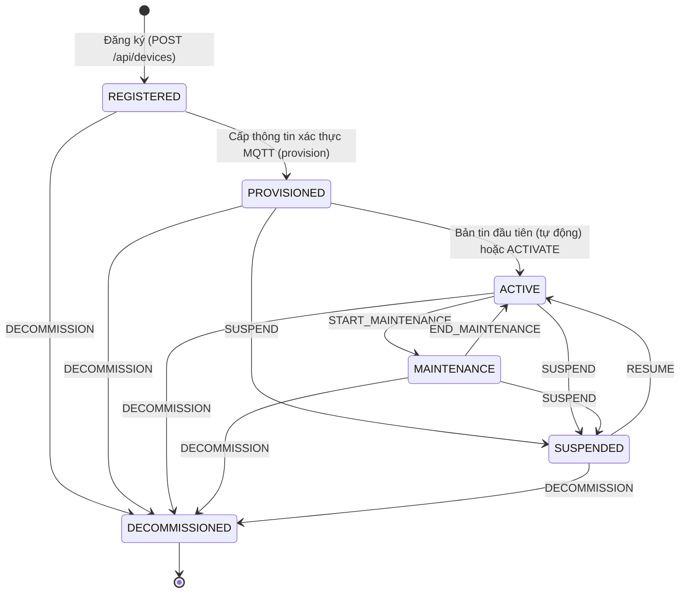
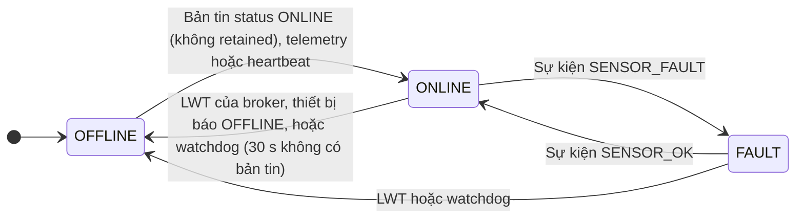

# Mô hình trạng thái vòng đời thiết bị – GasGuard

Mỗi thiết bị có **hai trạng thái độc lập**: **vòng đời** (`lifecycle_status`, 6 trạng thái, do người quản lý thay đổi
hoặc hệ thống tự kích hoạt) và **kết nối** (`connectivity`: ONLINE / OFFLINE / FAULT, do hệ thống tự cập nhật). Máy
trạng thái vòng đời nằm ở `backend/src/main/java/com/iot/gas/service/DeviceLifecycle.java`; chuyển trạng thái không
hợp lệ bị từ chối với HTTP 409.

## 1. Vòng đời

SUSPEND và DECOMMISSION bắt buộc nhập lý do. `DECOMMISSIONED` là trạng thái cuối: không có thao tác nào đưa thiết bị quay lại. Mã thiết bị cũng không dùng lại được
cho thiết bị mới.

### Ý nghĩa từng trạng thái

| Trạng thái | Ý nghĩa | Tài khoản MQTT | Nhận dữ liệu | Nhận lệnh | Sinh cảnh báo |
|---|---|---|---|---|---|
| `REGISTERED` | Đã khai báo trên hệ thống, chưa có thông tin xác thực | Chưa có | Không | Không | Không |
| `PROVISIONED` | Đã cấp tài khoản MQTT riêng, chờ thiết bị kết nối lần đầu | Hoạt động | Có | Không | Không |
| `ACTIVE` | Đang hoạt động bình thường | Hoạt động | Có | Có | **Có** |
| `MAINTENANCE` | Đang bảo trì: vẫn gửi dữ liệu và điều khiển được, nhưng không báo động | Hoạt động | Có | Có | Không |
| `SUSPENDED` | Tạm khóa: broker ngắt kết nối và từ chối đăng nhập | Bị vô hiệu hóa | Không | Không | Không |
| `DECOMMISSIONED` | Ngừng sử dụng vĩnh viễn; dữ liệu lịch sử vẫn giữ để tra cứu | Bị xóa | Không | Không | Không |

"Nhận dữ liệu: Không" nghĩa là bản tin từ thiết bị bị từ chối và ghi audit `DEVICE_DATA_REJECTED` (tối đa 1 lần mỗi
phút cho mỗi thiết bị). Thường thiết bị ở các trạng thái này không gửi được gì vì broker đã chặn từ trước.

### Các thao tác chuyển trạng thái

Mọi thao tác dưới đây chỉ **quản trị viên** hoặc **chủ thiết bị** được làm (kiểm tra ở backend); người được chia sẻ
quyền xem bị từ chối (HTTP 403). Mỗi thao tác ghi audit log kèm trạng thái trước, sau và lý do.

| Thao tác | API | Từ → đến | Điều kiện | Tác động lên broker và dữ liệu |
|---|---|---|---|---|
| Đăng ký | `POST /api/devices` | → REGISTERED | Vai trò ADMIN/OWNER; mã thiết bị duy nhất, đúng mẫu `^[a-z0-9][a-z0-9-]{2,39}$` | Gán chủ sở hữu (admin được gán cho người khác), vị trí, khu vực, phiên bản phần cứng |
| Cấp thông tin xác thực | `POST /api/devices/{code}/provision` | REGISTERED → PROVISIONED | Chỉ khi đang REGISTERED | Tạo tài khoản MQTT riêng (username = clientId = mã thiết bị) và ACL chỉ cho topic của chính nó; mật khẩu 24 ký tự hiện **một lần**, CSDL chỉ lưu SHA-256 |
| Kích hoạt | tự động, hoặc `POST …/lifecycle` `ACTIVATE` | PROVISIONED → ACTIVE | Backend nhận bản tin hợp lệ đầu tiên (telemetry, heartbeat, status ONLINE) | Audit `DEVICE_AUTO_ACTIVATED` khi tự kích hoạt |
| Bắt đầu / kết thúc bảo trì | `POST …/lifecycle` `START_MAINTENANCE` / `END_MAINTENANCE` | ACTIVE ⇄ MAINTENANCE | | Chỉ đổi trạng thái nghiệp vụ; không sinh cảnh báo trong lúc bảo trì |
| Tạm khóa | `POST …/lifecycle` `SUSPEND` | PROVISIONED / ACTIVE / MAINTENANCE → SUSPENDED | **Bắt buộc lý do** | Vô hiệu hóa tài khoản MQTT, broker **ngắt kết nối ngay**; kết nối lại bị từ chối (CONNACK 135 với MQTT 5, mã 5 với MQTT 3.1.1 trên ESP32); thiết bị chuyển OFFLINE |
| Mở khóa | `POST …/lifecycle` `RESUME` | SUSPENDED → ACTIVE | | Bật lại tài khoản MQTT, thiết bị tự kết nối lại |
| Ngừng sử dụng | `POST …/lifecycle` `DECOMMISSION` | mọi trạng thái trừ DECOMMISSIONED → DECOMMISSIONED | **Bắt buộc lý do** | Xóa vĩnh viễn tài khoản MQTT, thu hồi thông tin xác thực, xóa cấu hình retained trên broker; ẩn khỏi danh sách thiết bị đang dùng; giữ lịch sử dữ liệu, cảnh báo, lệnh |
| Đổi mật khẩu thiết bị | `POST /api/devices/{code}/credentials/rotate` | Giữ nguyên trạng thái | Mọi trạng thái trừ REGISTERED, DECOMMISSIONED | Cấp mật khẩu mới, thu hồi mật khẩu cũ; phiên MQTT đang dùng mật khẩu cũ bị ngắt. Đang SUSPENDED thì tài khoản mới vẫn bị vô hiệu hóa |

Cấu hình từ xa (`PUT /api/devices/{code}/config`) gửi được ở mọi trạng thái trừ DECOMMISSIONED; cấu hình được giữ trên
broker dạng retained nên thiết bị nhận ngay khi kết nối.

## 2. Trạng thái kết nối

| Cơ chế | Khi nào | Độ trễ phát hiện |
|---|---|---|
| **LWT** (Last Will) | Thiết bị mất kết nối mà không kịp ngắt đúng cách: broker tự phát bản tin `status` OFFLINE thay thiết bị | Kết nối TCP bị đóng đột ngột: gần như ngay (đo được 1–3 s trong P4, F7). Mất điện hoặc mất WiFi (TCP không kịp đóng): broker chờ 1,5 × keepalive; ESP32 dùng keepalive 15 s nên khoảng 22 s |
| **Watchdog** backend | Thiết bị treo nhưng kết nối TCP chưa đứt, nên không có LWT | 30 s không nhận bản tin nào (`OFFLINE_TIMEOUT_SEC`) |
| Thao tác quản lý | SUSPEND, DECOMMISSION | Ngay lập tức |

Thiết bị ACTIVE chuyển OFFLINE hoặc FAULT thì sinh cảnh báo (`OFFLINE`, `FAULT`); có kết nối lại hoặc hết lỗi thì cảnh
báo được đánh dấu đã trở lại bình thường.

## 3. Đối chiếu với 10 bước của đề bài (mục 4.4b)

| # | Yêu cầu | Cách đáp ứng |
|---|---|---|
| 1 | Đăng ký / onboarding | `POST /api/devices` → REGISTERED |
| 2 | Cấp mã định danh và thông tin xác thực | Mã thiết bị duy nhất; `provision` tạo tài khoản MQTT riêng → PROVISIONED |
| 3 | Gán cho người dùng, nhóm, vị trí, khu vực | `owner_id` (admin gán chủ), `location`, `zone`; chia sẻ quyền xem cho người khác |
| 4 | Kích hoạt | Tự động khi nhận bản tin đầu tiên, hoặc `ACTIVATE` → ACTIVE |
| 5 | Cấu hình tham số từ xa | `PUT …/config`, có phiên bản, thiết bị xác nhận APPLIED / REJECTED |
| 6 | Theo dõi online/offline | `connectivity` với LWT và watchdog |
| 7 | Theo dõi phiên bản phần cứng và firmware | `hw_version` (nhập khi đăng ký, thiết bị gửi kèm status), `fw_version` (thiết bị gửi kèm status) |
| 8 | Ghi nhận lỗi hoặc bảo trì | `FAULT` (lỗi cảm biến) và `MAINTENANCE` |
| 9 | Tạm khóa hoặc thu hồi quyền kết nối | `SUSPEND` / `RESUME`; đổi mật khẩu (`credentials/rotate`) |
| 10 | Ngừng sử dụng (decommission) | `DECOMMISSION` → DECOMMISSIONED |

## 4. Quyết định thiết kế

- **Tách vòng đời và kết nối:** vòng đời là quyết định của con người (đưa vào dùng, bảo trì, khóa), kết nối là tình
  trạng kỹ thuật thay đổi liên tục. Gộp chung thì một lần mất mạng sẽ làm mất thông tin thiết bị đang bảo trì hay bị khóa.
- **Tự kích hoạt bằng bản tin đầu tiên:** chứng minh thiết bị đã nạp đúng thông tin xác thực và kết nối được, không cần
  thêm thao tác tay.
- **Khóa ở broker, không chỉ ở backend:** SUSPEND và DECOMMISSION thay đổi tài khoản trong Mosquitto Dynamic Security,
  nên thiết bị bị chặn ngay ở tầng kết nối, kể cả khi bản tin không đi qua backend.
- **Bắt buộc lý do** khi tạm khóa và ngừng sử dụng, lưu trong audit log, để truy vết ai khóa và vì sao.
- **MAINTENANCE vẫn nhận dữ liệu nhưng không cảnh báo:** kỹ thuật viên thử cảm biến (ví dụ xịt gas thử) mà không làm
  phát email báo động giả.
- **Ngừng sử dụng không xóa dữ liệu:** giữ lịch sử để tra cứu và đối chiếu; xóa cấu hình retained để thiết bị cũ
  (nếu còn) không nhận lại cấu hình.

## 5. Kiểm thử chứng minh

| Ca | Nội dung |
|---|---|
| F2 | Đăng ký → cấp xác thực → bản tin đầu tiên tự kích hoạt ACTIVE |
| F7 | Ngắt kết nối đột ngột → OFFLINE (LWT) và cảnh báo; kết nối lại → ONLINE |
| F9 | Tạm khóa (bắt buộc lý do), broker ngắt và từ chối kết nối, mở khóa, ngừng sử dụng, không kích hoạt lại được, lịch sử vẫn còn, audit đủ 3 thao tác |
| S7 | Đổi mật khẩu thiết bị: mật khẩu cũ bị từ chối, mật khẩu mới hoạt động |

Kết quả: `tests/reports/e2e-latest.md`.
