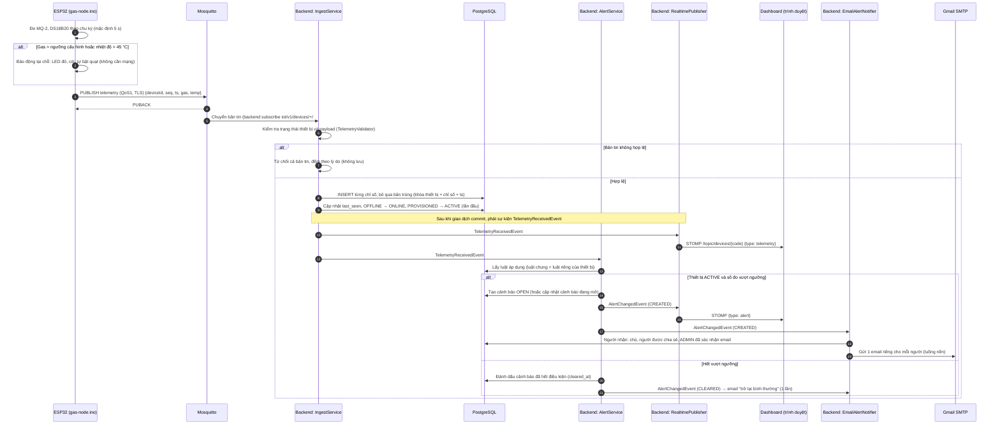
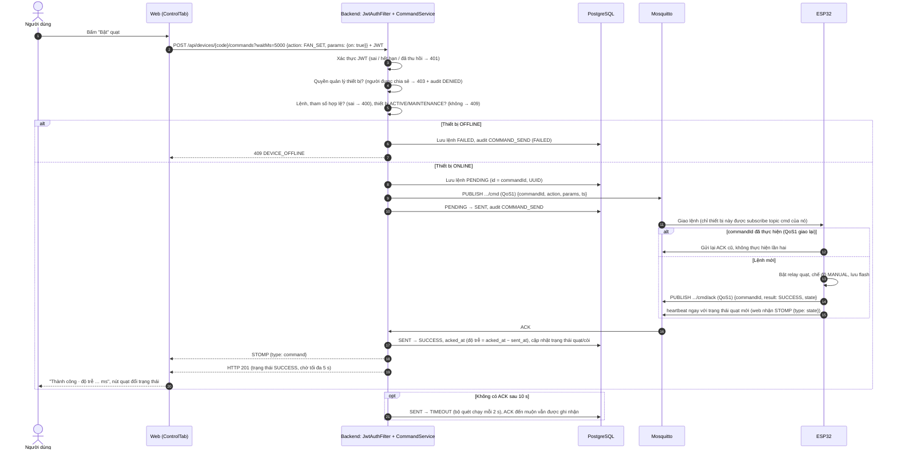
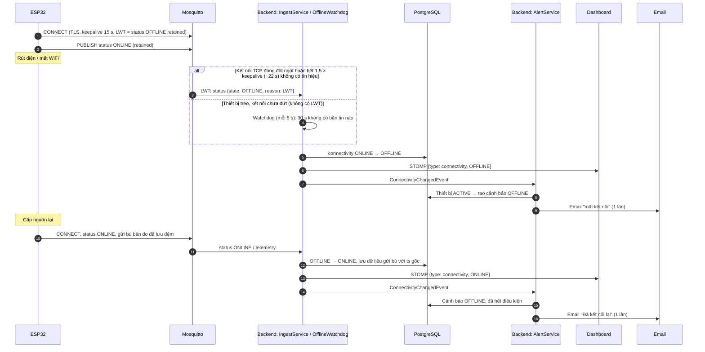

# Sơ đồ tuần tự – GasGuard

Ba quy trình quan trọng (đề bài yêu cầu tối thiểu hai): **(1)** thiết bị gửi số đo, hệ thống lưu, cập nhật dashboard
và sinh cảnh báo; **(2)** người dùng gửi lệnh điều khiển và nhận xác nhận; **(3)** phát hiện thiết bị mất kết nối.
Tên lớp trong sơ đồ là lớp thật trong `backend/src/main/java/com/iot/gas/`.

## 1. Telemetry → lưu → dashboard → cảnh báo → email

Điểm cần nắm:

- **Báo động tại chỗ không phụ thuộc mạng:** ESP32 tự bật còi, LED, quạt; backend chỉ ghi nhận và báo cho người ở xa.
- **QoS1 + chống trùng:** broker có thể giao lại bản tin; khóa duy nhất trong CSDL bỏ bản trùng, nên không lưu hai lần.
- **Dashboard và cảnh báo chạy sau khi lưu thành công** (`@TransactionalEventListener`): không bao giờ hiện số liệu
  chưa được lưu.
- **Email không làm chậm luồng chính:** gửi trên luồng nền, mỗi người nhận một email riêng; mỗi cảnh báo tối đa 1 email
  khi xảy ra và 1 email khi trở lại bình thường.

## 2. Gửi lệnh điều khiển và nhận xác nhận (ACK)

Điểm cần nắm:

- **Kiểm tra quyền ở backend**, trước khi lệnh rời khỏi hệ thống; mọi lệnh đều được lưu lịch sử kèm người gửi và kết quả.
- **`commandId` ghép lệnh với ACK** và giúp thiết bị bỏ qua lệnh bị giao trùng.
- **Không gửi lệnh khi thiết bị OFFLINE:** lệnh QoS1 không retained sẽ không tới được, nên trả lỗi ngay thay vì chờ.

## 3. Phát hiện thiết bị mất kết nối

Điểm cần nắm:

- **Hai cơ chế bổ sung nhau:** LWT do broker phát (nhanh, không cần backend dò), watchdog bắt trường hợp thiết bị treo
  mà kết nối chưa đứt.
- **Không mất dữ liệu khi mất mạng ngắn:** thiết bị vẫn đo, lưu đệm tối đa 120 bản, kết nối lại thì gửi bù.

## Kiểm thử chứng minh

| Quy trình | Ca kiểm thử |
|---|---|
| 1 | F3 (telemetry lưu và truy vấn), F4 (dashboard realtime, độ trễ đo được), F8 (sinh và xử lý cảnh báo), S5 (từ chối payload sai), P1, P5 |
| 2 | F5 (lệnh, ACK, TIMEOUT), S2 (người được chia sẻ không gửi được lệnh), P2 |
| 3 | F7 (offline bằng LWT, cảnh báo, online lại), P4 (gửi bù sau mất mạng) |
