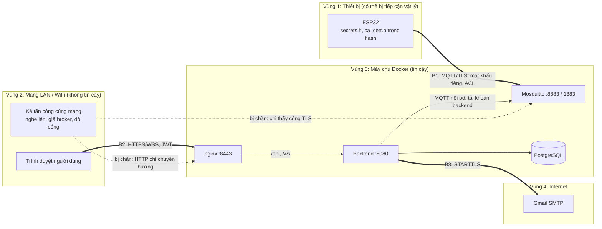

# Mô hình mối đe dọa – GasGuard

Phân tích theo phương pháp **STRIDE** (giả mạo, sửa đổi, chối bỏ, lộ thông tin, từ chối dịch vụ, leo thang quyền) trên
các ranh giới tin cậy của hệ thống. Mỗi mối đe dọa ghi rõ biện pháp đã làm (kèm vị trí trong code) và ca kiểm thử chứng
minh. Phần cuối liệt kê rủi ro còn lại mà nhóm chấp nhận ở mức nguyên mẫu.

## 1. Tài sản cần bảo vệ

| Tài sản | Vì sao quan trọng |
|---|---|
| Lệnh điều khiển quạt, còi và cấu hình thiết bị (ngưỡng gas, chu kỳ gửi) | Lệnh giả hoặc cấu hình sai có thể tắt quạt, tắt còi, nâng ngưỡng làm chậm báo động |
| Dữ liệu đo gas, nhiệt độ và cảnh báo | Dữ liệu giả gây báo động giả hoặc che giấu rò rỉ thật; dữ liệu thật cho biết thói quen sinh hoạt của gia đình |
| Tài khoản người dùng, mật khẩu, JWT | Chiếm tài khoản là chiếm quyền điều khiển thiết bị |
| Mật khẩu MQTT của từng thiết bị | Ai có mật khẩu có thể giả làm thiết bị |
| Bí mật máy chủ: `JWT_SECRET`, mật khẩu CSDL, mật khẩu MQTT `backend`/`admin`, khóa CA và khóa TLS máy chủ, mật khẩu ứng dụng Gmail | Lộ bất kỳ thứ nào là mất an toàn toàn hệ thống |
| Thông tin cá nhân: tên, email, IP trong audit log | Quyền riêng tư của người dùng |
| Audit log | Bằng chứng ai đã làm gì, khi nào |

## 2. Ranh giới tin cậy

| Ranh giới | Dữ liệu đi qua | Kiểm soát chính |
|---|---|---|
| B1: thiết bị ↔ broker | Telemetry, heartbeat, status, event, lệnh, cấu hình, ACK | TLS 1.2+ (ESP32 kiểm tra chứng chỉ broker bằng CA của nhóm), mật khẩu riêng từng thiết bị, ACL theo topic |
| B2: trình duyệt ↔ máy chủ | Đăng nhập, API, dữ liệu realtime | HTTPS TLS 1.2/1.3, JWT, kiểm tra quyền ở backend |
| B3: máy chủ ↔ Internet | Email cảnh báo, mã xác nhận email | STARTTLS cổng 587, mật khẩu ứng dụng Gmail |
| Bên trong máy chủ | Backend ↔ broker, CSDL | Mạng Docker riêng; cổng không mã hóa (1883, 8080) chỉ bind `127.0.0.1` |

## 3. Tác nhân đe dọa

| Tác nhân | Khả năng giả định |
|---|---|
| Người cùng mạng WiFi (khách, hàng xóm dò được WiFi) | Nghe lén, dò cổng, dựng broker hoặc web giả, gửi gói tin tùy ý |
| Người dùng hợp lệ tò mò hoặc có ý xấu | Có tài khoản VIEWER/OWNER, thử xem hoặc điều khiển thiết bị không phải của mình, sửa token |
| Người được chia sẻ thiết bị | Có quyền xem, thử điều khiển hoặc đổi cấu hình |
| Người lấy được một thiết bị | Đọc flash ESP32, lấy mật khẩu MQTT của thiết bị đó |
| Người dò mật khẩu qua Internet/LAN | Thử đăng nhập hàng loạt |

Ngoài phạm vi: kẻ tấn công đã chiếm quyền quản trị máy chủ Docker, tấn công chuỗi cung ứng thư viện.

## 4. Phân tích STRIDE

### 4.1 Giả mạo (Spoofing)

| Mối đe dọa | Biện pháp | Ở đâu | Kiểm thử |
|---|---|---|---|
| Thiết bị giả gửi dữ liệu hoặc nhận lệnh thay thiết bị thật | Mỗi thiết bị một tài khoản MQTT, username = clientId = mã thiết bị; mật khẩu 24 ký tự từ 18 byte `SecureRandom`; broker cấm ẩn danh | `DeviceService.generatePassword`, `DynsecClient.createDeviceAccount`, `mosquitto.conf` (`allow_anonymous false`) | S4 (sai mật khẩu, mật khẩu của A cho tên B, sai clientId, ẩn danh đều bị từ chối) |
| Broker giả trong LAN lừa ESP32 kết nối để lấy mật khẩu hoặc gửi lệnh giả | ESP32 kết nối TLS (`MQTT_USE_TLS 1`, mặc định trong `secrets.h.example`) và kiểm tra chứng chỉ broker bằng CA của nhóm (`setCACert`): broker không có chứng chỉ do CA nhóm ký thì không bắt tay được; đồng bộ NTP trước khi bắt tay để kiểm tra hạn chứng chỉ | `gas-node.ino`, `ca_cert.h` | S9 (bắt tay thất bại khi client không tin CA của chứng chỉ), H1 |
| Đăng nhập bằng tài khoản người khác (dò mật khẩu) | BCrypt cost 12; sai 5 lần khóa tạm 15 phút (HTTP 423); cùng một thông báo lỗi cho sai tên và sai mật khẩu; chính sách mật khẩu 8–72 ký tự có chữ và số | `AuthService.login`, `PasswordPolicy` | S6 |
| Giả mạo token (sửa vai trò thành ADMIN, token rác, token hết hạn) | JWT HS256 với `JWT_SECRET` ≥ 32 byte (backend không khởi động nếu ngắn hơn); hạn 60 phút; vai trò lấy từ CSDL, không tin claim trong token | `JwtService`, `JwtAuthFilter` | S3 |
| Dùng lại token đã đăng xuất hoặc của tài khoản đã bị khóa/đổi quyền | Claim `ver` so với `users.token_version`; đăng xuất, đổi mật khẩu, đổi vai trò, khóa tài khoản đều tăng `token_version` | `JwtAuthFilter`, `StompAuthInterceptor` | S3, F1 |
| Giả IP trong audit log bằng header `X-Forwarded-For` | nginx ghi đè `X-Forwarded-For` bằng IP thật của kết nối; backend chỉ tin header từ proxy nội bộ | `nginx.conf`, `server.forward-headers-strategy: native` | |

### 4.2 Sửa đổi dữ liệu (Tampering)

| Mối đe dọa | Biện pháp | Ở đâu | Kiểm thử |
|---|---|---|---|
| Sửa dữ liệu hoặc lệnh trên đường truyền | TLS trên mọi kết nối ra LAN; cổng không mã hóa không mở ra LAN | `mosquitto.conf`, `nginx.conf`, `docker-compose.yml` | S9 |
| Thiết bị A ghi dữ liệu vào topic của thiết bị B, hoặc tự gửi lệnh | ACL Dynamic Security: thiết bị chỉ publish topic dữ liệu của chính nó, chỉ subscribe `cmd`/`config` của chính nó; backend còn kiểm tra `deviceId` trong payload phải trùng topic | `DynsecClient`, `IngestService` (`DEVICE_ID_MISMATCH`) | S4, S5 |
| Payload độc hại hoặc sai (JSON hỏng, giá trị ngoài dải, trường lạ, quá lớn) | Từ chối cả bản tin nếu: lớn hơn 4 KB, không phải JSON object, có trường ngoài danh sách cho phép, sai đơn vị (`ppm`, `C`), ngoài dải (gas 0–10000, nhiệt −55–125), thiếu `ts`, `ts` trước 2024, lệch tương lai > 2 phút hoặc cũ hơn 7 ngày; đếm theo lý do | `TelemetryValidator`, `IngestService` | S5 |
| Gửi lại bản tin cũ (replay) để làm sai dữ liệu | Khóa duy nhất (thiết bị, chỉ số, `ts`) bỏ bản trùng; cửa sổ thời gian nêu trên | `TelemetryRepository`, `TelemetryValidator` | P5 |
| Gửi lại lệnh cũ, hoặc broker giao lệnh hai lần (QoS1) | `commandId` (UUID) ghép lệnh với ACK; ESP32 nhớ 10 `commandId` gần nhất, trùng thì gửi lại ACK cũ, không thực hiện lần hai | `gas-node.ino` (`CMD_MEMORY`) | F5 |
| Lệnh hoặc cấu hình nguy hiểm (lệnh lạ, ngưỡng gas vô lý) | Chỉ nhận 5 lệnh (`FAN_SET`, `BUZZER_SET`, `FAN_AUTO`, `BUZZER_AUTO`, `PING`) với tham số đúng kiểu; cấu hình: chu kỳ 1–3600 s, ngưỡng gas 50–10000 ppm. Kiểm tra **hai lần**: ở backend (HTTP 400) và ở firmware (trả `config/ack` lỗi) | `CommandService.validate`, `DeviceConfigRequest`, `gas-node.ino` | F5, F6 |
| Người không có quyền sửa cấu hình, gửi lệnh | Kiểm tra quyền quản lý ở backend trước khi lệnh rời hệ thống | `AccessService.requireManage` | S1, S2 |

### 4.3 Chối bỏ (Repudiation)

| Mối đe dọa | Biện pháp | Ở đâu | Kiểm thử |
|---|---|---|---|
| Người dùng chối đã gửi lệnh, đổi cấu hình, khóa thiết bị | Audit log ghi người thực hiện, thao tác, đối tượng, kết quả (`SUCCESS`/`FAILED`/`DENIED`), IP, thời gian cho: đăng nhập, đăng xuất, quản lý người dùng, đăng ký/cấp xác thực/đổi mật khẩu/vòng đời thiết bị, lệnh, cấu hình, chia sẻ, luật cảnh báo, xác nhận/xử lý cảnh báo, xuất CSV, truy cập bị từ chối | `AuditService`, bảng `audit_logs` | S8, S1 |
| Sửa hoặc xóa audit log để xóa dấu vết | API audit chỉ có `GET`; không có API sửa, xóa | `AuditController` | |
| Không biết lệnh nào đã thực hiện thật | Lịch sử lệnh lưu người gửi, thời điểm gửi, thời điểm ACK, kết quả từ thiết bị, độ trễ | `CommandService`, bảng `commands` | F5 |

### 4.4 Lộ thông tin (Information disclosure)

| Mối đe dọa | Biện pháp | Ở đâu | Kiểm thử |
|---|---|---|---|
| Nghe lén mật khẩu, JWT, dữ liệu trong WiFi | TLS cho MQTT thiết bị và web; HTTP chỉ trả 301 sang HTTPS | `mosquitto.conf`, `nginx.conf` | S9 |
| Lộ bí mật lên GitHub | Bí mật chỉ nằm trong `.env`, `secrets.h`, `ca_cert.h`, `deployment/certs/`; tất cả trong `.gitignore`; repo chỉ có file mẫu | `.gitignore`, `.env.example`, `secrets.h.example` | Kiểm tra `git ls-files` trước khi nộp |
| Lộ mật khẩu từ CSDL | Mật khẩu người dùng: BCrypt; mật khẩu thiết bị: chỉ lưu SHA-256 để đối chiếu, mật khẩu chỉ hiện **một lần** khi cấp; mã xác nhận email lưu SHA-256; API không trả băm mật khẩu | `SecurityConfig`, `DeviceService`, `EmailAlertService` | S8, F2 |
| Xem dữ liệu thiết bị của người khác (qua API hoặc WebSocket) | Kiểm tra quyền xem theo từng thiết bị trên mọi API có `{code}`; WebSocket kiểm tra JWT khi CONNECT và quyền xem khi SUBSCRIBE; danh sách chỉ trả thiết bị được phép | `AccessService`, `StompAuthInterceptor` | S1 |
| Thiết bị đọc dữ liệu, lệnh của thiết bị khác | ACL: thiết bị không subscribe được topic thiết bị khác, không subscribe được `#` | Dynamic Security | S4 |
| Email cảnh báo lộ địa chỉ người nhận khác | Mỗi người nhận một email riêng; chỉ gửi tới email đã xác nhận bằng mã (hạn 10 phút, tối đa 5 lần nhập sai) | `EmailAlertNotifier`, `EmailAlertService` | |
| Lộ phiên bản phần mềm, bị nhúng vào trang khác | `server_tokens off`; header `X-Frame-Options: DENY`, `X-Content-Type-Options: nosniff`, `Referrer-Policy: no-referrer` | `nginx.conf` | |
| Lộ khóa CA | Khóa CA ở `deployment/certs/ca/`, không gắn vào container nào; container chỉ đọc thư mục chứng chỉ máy chủ | `docker-compose.yml` | |

### 4.5 Từ chối dịch vụ (Denial of service)

| Mối đe dọa | Biện pháp | Ở đâu | Kiểm thử |
|---|---|---|---|
| Mất mạng, broker hoặc backend khởi động lại làm mất cảnh báo | **Báo động tại chỗ không phụ thuộc mạng** (LED đỏ, còi, tự bật quạt); ESP32 đệm 120 bản đo và gửi bù; QoS1 + phiên bền cho backend; container `restart: unless-stopped` | `gas-node.ino`, `MqttGateway`, `docker-compose.yml` | P4, H5, H7 |
| Thiết bị treo mà không ai biết | LWT của broker + watchdog 30 s ở backend → cảnh báo OFFLINE và email | `IngestService`, `OfflineWatchdog` | F7 |
| Bản tin quá lớn, dữ liệu rác làm đầy CSDL | Giới hạn 4 KB mỗi bản tin MQTT; 1 MB mỗi request HTTP; bản tin sai bị bỏ, không lưu | `TelemetryValidator`, `nginx.conf` | S5 |
| Thiết bị bị khóa vẫn gửi dữ liệu liên tục | Tạm khóa (`SUSPEND`) tắt tài khoản MQTT, broker ngắt kết nối ngay; ngừng sử dụng xóa hẳn tài khoản; dữ liệu từ thiết bị không ở trạng thái nhận bị bỏ | `DeviceService.changeLifecycle`, `IngestService.blocked` | F9, S7 |
| Dò mật khẩu làm quá tải | Khóa tạm sau 5 lần sai | `AuthService` | S6 |
| Spam email | Mỗi cảnh báo tối đa 1 email khi xảy ra và 1 email khi trở lại bình thường; không gửi cho thiết bị kiểm thử (`e2e-`, `perf-`) | `EmailAlertNotifier` | `EmailAlertNotifierTest` |

### 4.6 Leo thang quyền (Elevation of privilege)

| Mối đe dọa | Biện pháp | Ở đâu | Kiểm thử |
|---|---|---|---|
| VIEWER hoặc OWNER gọi API quản trị | `/api/admin/**` chỉ ADMIN (URL + `@PreAuthorize`) | `SecurityConfig`, `AdminUserController` | F1 |
| Người được chia sẻ (quyền xem) gửi lệnh, đổi cấu hình, đổi mật khẩu thiết bị, khóa thiết bị | Mọi thao tác ghi kiểm tra `requireManage` ở backend, không dựa vào giao diện ẩn nút | `AccessService`, `CommandService`, `ConfigService`, `DeviceService` | S2 |
| OWNER thao tác thiết bị của OWNER khác | Quyền quản lý = ADMIN hoặc (OWNER **và** là chủ thiết bị) | `AccessService` | S1 |
| Tự đăng ký để có quyền cao | Tự đăng ký luôn nhận VIEWER; chỉ ADMIN đổi vai trò | `AuthService.register`, `UserService` | F1 |
| ADMIN vô tình tự khóa hoặc tự hạ quyền, hệ thống mất quản trị | Chặn tự đổi vai trò, tự khóa chính mình | `UserService` (`SELF_ROLE_CHANGE`, `SELF_LOCK`) | |
| Thiết bị bị chiếm dùng mật khẩu để làm việc khác | Tài khoản thiết bị chỉ có quyền trên topic của chính nó, không có quyền Dynamic Security | Dynamic Security | S4 |

## 5. Rủi ro còn lại

| Rủi ro | Mức | Lý do chấp nhận / cách giảm |
|---|---|---|
| Mật khẩu WiFi và MQTT nằm dạng rõ trong flash ESP32 (chưa bật flash encryption, secure boot) | Trung bình | Người lấy được thiết bị chỉ giả được **chính thiết bị đó** (ACL); chủ thiết bị đổi mật khẩu (rotate) hoặc ngừng sử dụng để thu hồi ngay. Hướng phát triển: flash encryption, chứng chỉ client (mTLS) |
| JWT lưu trong `localStorage` của trình duyệt, có thể bị đọc nếu web dính XSS | Thấp | React tự escape dữ liệu khi hiển thị, không dùng `dangerouslySetInnerHTML`; token hạn 60 phút và thu hồi được khi đăng xuất. Hướng phát triển: cookie `HttpOnly` + CSP |
| Kẻ xấu cố tình nhập sai mật khẩu để khóa tài khoản người khác | Thấp | Khóa tạm tự hết sau 15 phút, ADMIN mở khóa được; mọi lần thử đều ghi audit kèm IP |
| Chưa giới hạn tần suất cho API (ngoài đăng nhập) và cho từng thiết bị ở broker | Thấp | Hệ thống chạy trong LAN, mọi API cần đăng nhập; đo được 100 thiết bị × 1 bản tin/s không mất bản tin (P8) |
| Chủ thiết bị có thể tắt quạt/còi bằng tay khi đang báo động | Chấp nhận | Là tính năng (tắt còi khi đã biết sự cố); chỉ người có quyền quản lý làm được, có audit; **LED đỏ vẫn sáng** khi gas cao dù đã tắt còi |
| CA tự tạo, không có tên miền công khai | Thấp | Đủ cho LAN; mỗi máy dùng web phải cài CA. Hướng phát triển: tên miền và chứng chỉ công cộng |
| Cổng PostgreSQL 15432 ánh xạ ra máy chủ, không mã hóa | Thấp | Cần cho công cụ quản trị khi phát triển; có mật khẩu CSDL riêng; không mở cổng này trên tường lửa. Khi triển khai thật nên bind `127.0.0.1` hoặc bỏ ánh xạ cổng |
| Mã xác nhận email và trạng thái chống spam email lưu trong bộ nhớ | Thấp | Khởi động lại backend chỉ làm mất mã đang chờ (người dùng xin mã mới) |

## 6. Quyền riêng tư

- **Thu thập tối thiểu:** tên đăng nhập, họ tên, email (tùy chọn, phải xác nhận), IP trong audit log, số đo gas và nhiệt
  độ. Không thu thập vị trí GPS, hình ảnh, âm thanh.
- **Ai xem được:** chỉ chủ thiết bị, người được chủ chia sẻ và ADMIN; chủ thu hồi chia sẻ bất kỳ lúc nào.
- **Người dùng tự quyết:** bật, tắt nhận email cảnh báo; sửa thông tin cá nhân.
- **Thiết bị ngừng sử dụng:** tài khoản MQTT bị xóa, lịch sử vẫn giữ để tra cứu.

## 7. Kiểm thử chứng minh

| Nhóm STRIDE | Ca kiểm thử |
|---|---|
| Giả mạo | S3, S4, S6, S9 |
| Sửa đổi | S4, S5, P5, F5, F6 |
| Chối bỏ | S8, S1 (audit `DENIED`) |
| Lộ thông tin | S1, S8, S9 |
| Từ chối dịch vụ | F7, F9, S7, P4, P8 |
| Leo thang quyền | F1, S1, S2 |

Kết quả: `tests/reports/e2e-latest.md`, `docs/test-report.md`.
