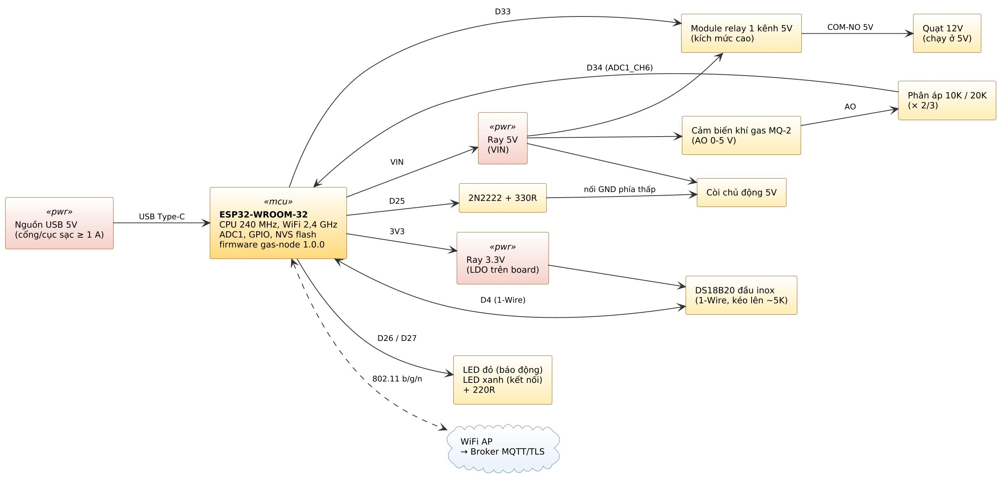
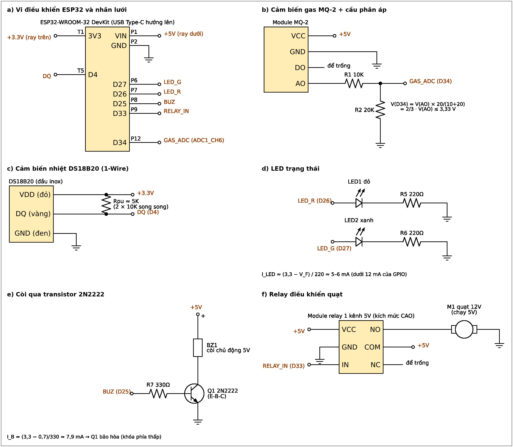
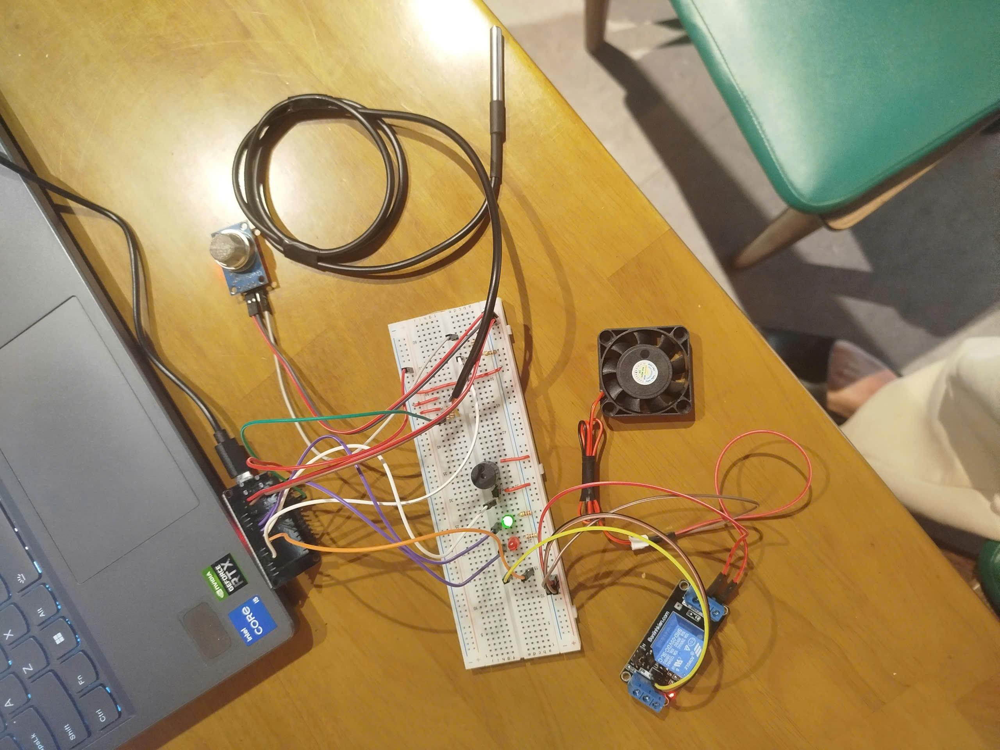
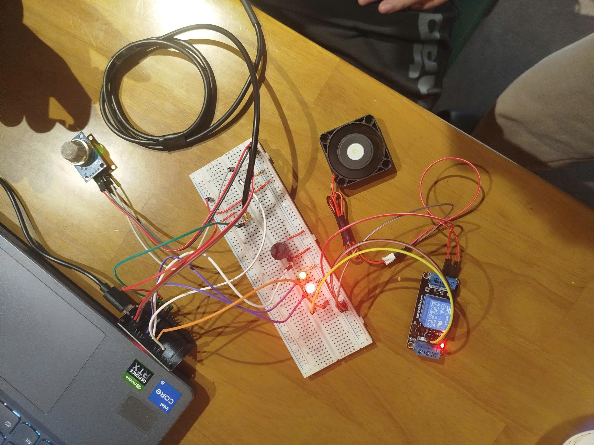
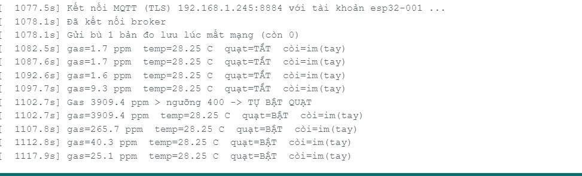

# Phần cứng GasGuard – sơ đồ lắp ráp

Thư mục gồm: sơ đồ khối, sơ đồ nguyên lý nối dây, danh sách linh kiện, hình ảnh nguyên mẫu (mục dưới) và bảng lắp ráp
chi tiết từng dây trên breadboard (từ mục *Linh kiện* trở đi). Chân ESP32 khớp với `firmware/gas-node/config.h`.

## Sơ đồ khối

Nguồn USB 5 V cấp cho ESP32 (ray 5 V qua chân VIN, ray 3,3 V từ LDO trên board). MQ-2 đọc qua cầu phân áp 10K/20K vào
ADC D34; DS18B20 trên bus 1-Wire D4; relay quạt D33; còi qua transistor 2N2222 ở D25; LED đỏ D26, LED xanh D27.

## Sơ đồ nguyên lý (nối cảm biến và cơ cấu chấp hành)

## Hình ảnh nguyên mẫu

| Mạch đã lắp ráp | Khi báo động: LED đỏ sáng, quạt chạy |
|---|---|
|  |  |

Serial Monitor khi kết nối lại broker, gửi bù số đo lưu lúc mất mạng rồi tự bật quạt khi gas vượt ngưỡng:

An toàn: toàn bộ mạch dùng điện áp thấp 5 V và 3,3 V từ USB, không đấu nối điện lưới 220 V; khi thử chỉ xả một lượng
nhỏ khí từ bật lửa gas (không đánh lửa) ở nơi thoáng.

## Lắp ráp chi tiết

**Quy ước:**
- Breadboard MB-102 830 lỗ đặt ngang. Hàng a ở mép dưới, hàng j ở mép trên, cột 1 bên trái. Ray dưới sát hàng a, ray trên sát hàng j.
- ESP32 đặt ngoài breadboard, cổng USB hướng lên, chân đếm từ phía USB xuống.
- **Ray dưới đỏ = 5V, ray trên đỏ = 3.3V. Hai ray đỏ KHÔNG BAO GIỜ nối với nhau.**
- Ray xanh trên và dưới = GND, có nối chung.

## Linh kiện

| Linh kiện | SL |
|---|---|
| ESP32-WROOM-32 Type C + dây USB | 1 |
| Breadboard MB-102 830 lỗ | 1 |
| Module cảm biến gas MQ-2 | 1 |
| Dây cảm biến nhiệt DS18B20 (đầu inox) | 1 |
| LED đỏ, LED xanh lá | 1 mỗi loại |
| Transistor 2N2222 | 1 |
| Còi chip 5V (chủ động) | 1 |
| Module relay 1 kênh 5V | 1 |
| Quạt 12V (chạy ở 5V) | 1 |
| Điện trở 220R (đỏ–đỏ–nâu) | 2 |
| Điện trở 330R (cam–cam–nâu) | 1 |
| Điện trở 10K (nâu–đen–cam) | 3 |
| Điện trở 20K (đỏ–đen–cam) | 1 |
| Dây đực–cái, dây đực–đực | ~15 mỗi loại |

## 1. Nguồn

| # | Dây | Từ | Đến |
|---|---|---|---|
| 1 | Đ-C đỏ | ESP32 phải-1 VN (5V) | Ray dưới đỏ (bên phải ngoài cùng) |
| 2 | Đ-C đen | ESP32 phải-2 GND | Ray dưới xanh (bên phải ngoài cùng) |
| 3 | Đ-Đ đỏ | Ray dưới đỏ dưới cột 28 | Ray dưới đỏ dưới cột 40 (cầu ray) |
| 4 | Đ-Đ đen | Ray dưới xanh dưới cột 28 | Ray dưới xanh dưới cột 40 (cầu ray) |
| 5 | Đ-C đỏ | ESP32 trái-1 3V3 | Ray trên đỏ, trên cột 51 |
| 6 | Đ-Đ đen | Ray dưới xanh dưới cột 51 | Ray trên xanh trên cột 51 |

## 2. Cảm biến gas MQ-2

| # | Linh kiện / dây | Từ | Đến |
|---|---|---|---|
| 7 | Đ-C đỏ | MQ-2 VCC | Ray dưới đỏ (bên phải ngoài cùng) |
| 8 | Đ-C đen | MQ-2 GND | Ray dưới xanh (bên phải ngoài cùng) |
| 9 | Đ-C | MQ-2 AO | e59 |
| 10 | Điện trở 10K | b55 | b59 |
| 11 | Điện trở 20K | a55 | Ray dưới xanh dưới cột 55 |
| 12 | Đ-C | e55 | ESP32 phải-12 D34 |
| – | MQ-2 DO | Để trống | |

Cầu phân áp: điện áp vào D34 = AO × 2/3, luôn dưới 3.3V (`MQ2_DIVIDER_RATIO = 1.5` trong firmware).

## 3. LED đỏ, LED xanh

| # | Linh kiện / dây | Từ | Đến |
|---|---|---|---|
| 13 | LED đỏ | chân dài c20 | chân ngắn c21 |
| 14 | 220R | a21 | Ray dưới xanh dưới cột 21 |
| 15 | Đ-C | e20 | ESP32 phải-7 D26 |
| 16 | LED xanh | chân dài c24 | chân ngắn c25 |
| 17 | 220R | a25 | Ray dưới xanh dưới cột 25 |
| 18 | Đ-C | e24 | ESP32 phải-6 D27 |

## 4. Còi qua transistor 2N2222

| # | Linh kiện / dây | Từ | Đến |
|---|---|---|---|
| 19 | 2N2222 (mặt chữ hướng về hàng a) | E c30, B c31, C c32 | |
| 20 | Điện trở 330R | d28 | d31 |
| 21 | Còi | chân − e32 | chân + e35 |
| 22 | Đ-Đ đen | a30 | Ray dưới xanh dưới cột 30 |
| 23 | Đ-Đ đỏ | a35 | Ray dưới đỏ dưới cột 35 |
| 24 | Đ-C | e28 | ESP32 phải-8 D25 |

## 5. Relay + quạt (relay đặt ngoài breadboard, bên trái)

| # | Linh kiện / dây | Từ | Đến |
|---|---|---|---|
| 25 | Đ-C đỏ | Relay VCC | Ray dưới đỏ dưới cột 12 |
| 26 | Đ-C đen | Relay GND | Ray dưới xanh dưới cột 12 |
| 27 | Đ-C | Relay IN | e15 |
| 28 | Đ-C | a15 | ESP32 phải-9 D33 |
| 29 | Đ-Đ đỏ | Cọc vít COM | Ray dưới đỏ dưới cột 14 |
| 30 | Dây quạt đỏ (+) | Cọc vít NO | |
| 31 | Dây quạt đen (−) | Ray dưới xanh dưới cột 14 | |
| – | Cọc vít NC | Để trống | |

Module relay của nhóm **kích mức CAO** (D33 = HIGH thì relay đóng, quạt chạy), tương ứng `RELAY_ACTIVE_LOW 0` trong firmware. Nếu thay bằng module kích mức thấp thì đặt `1`: khi đó firmware tắt quạt bằng cách thả nổi chân D33, vì relay nuôi 5V có thể không nhả với mức 3.3V.

## 6. Cảm biến nhiệt DS18B20 (nửa trên)

| # | Linh kiện / dây | Từ | Đến |
|---|---|---|---|
| 32 | Sợi vàng (DATA) | f45 | |
| 33 | Sợi đỏ (VCC) | f47 | |
| 34 | Sợi đen (GND) | f49 | |
| 35 | Điện trở 10K thứ nhất | g45 | g47 |
| 36 | Điện trở 10K thứ hai | h45 | h47 |
| 37 | Đ-Đ đỏ | j47 | Ray trên đỏ (3.3V) trên cột 47 |
| 38 | Đ-Đ đen | j49 | Ray trên xanh trên cột 49 |
| 39 | Đ-C | i45 | ESP32 trái-5 D4 |

Hai điện trở 10K song song cho khoảng 5K, làm điện trở kéo lên cho đường DATA.

## Bảng chân ESP32 ↔ firmware (`firmware/gas-node/config.h`)

| Chân | Tên | Chức năng | Chiều | Hằng số firmware |
|---|---|---|---|---|
| Phải-1 | VN | Nguồn 5V ra ray dưới | – | |
| Phải-2 | GND | GND | – | |
| Phải-6 | D27 | LED xanh (trạng thái kết nối) | Ra | `PIN_LED_GREEN 27` |
| Phải-7 | D26 | LED đỏ (báo động gas / quá nhiệt / lỗi cảm biến) | Ra | `PIN_LED_RED 26` |
| Phải-8 | D25 | Còi (qua 2N2222) | Ra | `PIN_BUZZER 25` |
| Phải-9 | D33 | Relay → quạt | Ra | `PIN_RELAY 33` |
| Phải-12 | D34 | MQ-2 (qua phân áp) | Vào (ADC1) | `PIN_MQ2_AO 34` |
| Trái-1 | 3V3 | Nguồn 3.3V ra ray trên | – | |
| Trái-5 | D4 | DS18B20 DATA | Vào/ra (1-Wire) | `PIN_DS18B20 4` |

## Kiểm tra nhanh khi cấp nguồn

- Khởi động: 2 LED sáng khoảng 0.5 s và còi bíp ngắn (tự kiểm tra mạch LED/còi). Quạt **không** được chạy.
- Còi kêu liên tục ngay khi cấp điện: kiểm tra chân B/C của 2N2222 và điện trở 330R.
- Quạt chạy ngay khi cấp điện: đổi `RELAY_ACTIVE_LOW` hoặc kiểm tra dây COM/NO (NC phải để trống).
- Tổng dòng (MQ-2 ~150 mA, relay ~70 mA, quạt) lấy từ cổng USB. Dùng cổng/cục sạc ≥1 A để tránh ESP32 reset khi quạt bật.
